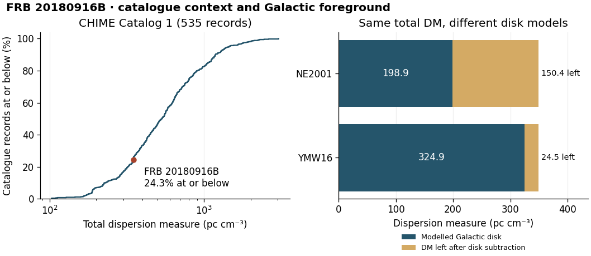

# Six Seconds Through the Cosmic Web

An evidence-led study of **FRB 20180916B** using all **535 one-event records** in the public CHIME/FRB Catalog 1 JSON. The interface shows the cold-plasma sweep predicted by the catalogue DM, the burst’s position in the survey distribution, and the disagreement between Galactic electron models.

## Results



The left panel counts catalogue records at or below each DM. The right panel subtracts each Galactic disk prediction from the same measured total. The remainder can contain halo, intergalactic and host contributions. [Open the evidence figure and data](https://biswajit1999.github.io/frb-dispersion-measure-lab/#catalogue-figure). Install NumPy and Matplotlib, then run `python scripts/plot_dispersion_evidence.py` to regenerate it.

- Catalogued DM: **349.349 ± 0.006 pc cm⁻³**
- Predicted 400-to-800 MHz cold-plasma delay: **6.79398 s**
- Pulse width in this catalog record: **0.765 ms**
- Catalog percentile: **24.3%** (535-event JSON; median DM 533.1 pc cm⁻³)
- Excess after NE2001 Galactic-disk subtraction: **150.4 pc cm⁻³**
- Excess after YMW16 Galactic-disk subtraction: **24.5 pc cm⁻³**

The 126 pc cm⁻³ foreground-model spread is the main result of the sightline audit. At Galactic latitude +3.73°, total DM cannot be cleanly divided into Milky Way, halo, IGM and host terms without additional assumptions. The localized host redshift, z = 0.0337 ± 0.0002, supplies distance independently; DM alone does not.

## Reproduce

```bash
python -m pip install -r requirements-research.txt
python scripts/derive_chime_catalog.py
npm run check
npm run validate:research
```

`data/chime-catalog-1.json` is preserved as downloaded. The derivation script writes the compact browser payload, distribution bins, event records, ν⁻² curve and foreground comparison to `data/frb20180916b-analysis.json`.

## Provenance

- CHIME/FRB Collaboration et al. (2021), *The First CHIME/FRB Fast Radio Burst Catalog*, ApJS 257, 59, [doi:10.3847/1538-4365/ac33ab](https://doi.org/10.3847/1538-4365/ac33ab).
- Marcote et al. (2020), *A repeating fast radio burst source localized to a nearby spiral galaxy*, Nature 577, 190–194, [doi:10.1038/s41586-019-1866-z](https://doi.org/10.1038/s41586-019-1866-z).
- CHIME/FRB Collaboration (2020), *Periodic activity from a fast radio burst source*, Nature 582, 351–355.

The JSON representation has 535 records because it stores one entry per event; the catalog paper describes 536 bursts/components and 62 bursts from 18 previously reported repeating sources. The difference is documented in the CHIME open-data ecosystem as multi-component handling rather than silently ignored.

## Scope

Measured: total DM, reported uncertainty, sky position and profile quantities. Derived: exact cold-plasma delay, survey percentile and the two catalogued Galactic-model excesses. Not inferred: a unique IGM column, unique host contribution, DM-only redshift, or progenitor mechanism.

Biswajit Jana, 2026. MIT License.

## Research evidence and downloads

- [Browse the evidence file index](evidence/manifest.json) or open `evidence.html` from the checkout to inspect previews and downloads.
- Start with [Chime catalog 1](data/chime-catalog-1.json), [Frb20180916b analysis](data/frb20180916b-analysis.json).

Run these commands from the repository root to rebuild the published evidence.

```sh
python scripts/evidence_catalog.py
python scripts/render_evidence_page.py
```
